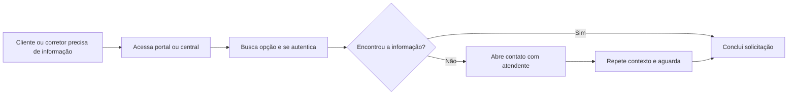
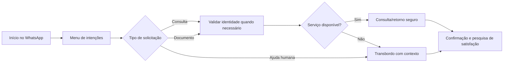
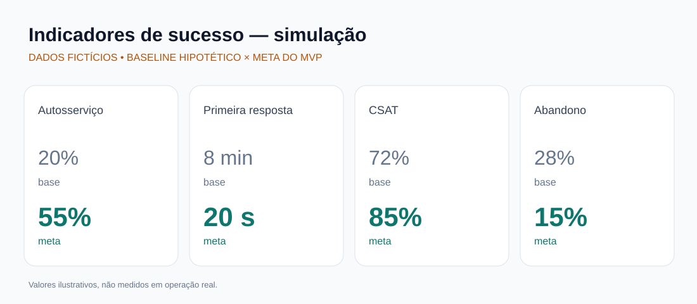

# Case de Portfólio | Automação de atendimento pelo WhatsApp

**Análise de Negócios • Descoberta de processos • Jornada do usuário • Requisitos • Indicadores**

> **PROJETO DEMONSTRATIVO — DADOS FICTÍCIOS.** Este estudo de caso foi estruturado para demonstrar competências profissionais. Os indicadores, volumes, metas e resultados abaixo são **simulações**, não números obtidos em produção nem resultados comprovados de cliente. Não se trata de implantação em ambiente real.

## 1. Visão executiva

**Cenário:** uma seguradora fictícia deseja oferecer autosserviço via WhatsApp a clientes e corretores, reduzindo a dependência de um portal web para consultas e solicitações recorrentes.

**Desafio de negócio:** jornadas fragmentadas, necessidade de múltiplos acessos, demora para informações simples e baixa visibilidade sobre motivos de contato.

**Proposta (TO BE):** atendimento conversacional com menus orientados à intenção, validação de identidade, integração controlada a serviços, consulta de status, envio de documentos permitidos e transbordo para atendimento humano com contexto preservado.

**Papel ilustrado neste portfólio:** descoberta e mapeamento de processo, identificação de dores, desenho de jornada futura, especificação de requisitos, definição de KPIs e critérios de aceite. Este repositório **não contém um chatbot implementado**.

## 2. Objetivos e benefícios esperados

| Objetivo | Benefício potencial | Como verificar |
| --- | --- | --- |
| Facilitar autosserviço | Menos esforço para obter informações | Taxa de resolução sem agente |
| Diminuir espera | Resposta inicial rápida | Tempo da primeira resposta |
| Otimizar operação | Menos demandas repetitivas direcionadas a agentes | Percentual de encaminhamento ao atendimento humano |
| Melhorar experiência | Jornadas simples e consistentes | CSAT após encerramento |
| Aumentar rastreabilidade | Melhor análise de gargalos e falhas | Logs de etapas e taxa de abandono |
| Preservar segurança | Reduzir exposição de dados sensíveis | Auditoria de acessos e consentimento |

## 3. Jornada atual e futura

### AS IS — hipótese de processo

### TO BE — proposta demonstrativa

**Cuidados de desenho:** consentimento e privacidade (LGPD), acessibilidade da linguagem, alternativas de navegação, tratamento de falhas de integração, proteção de dados, encaminhamento a atendimento humano e registro auditável.

## 4. Escopo do MVP proposto

- Menu inicial orientado a necessidades frequentes.
- Identificação contextual de cliente ou corretor.
- Autenticação proporcional ao risco da informação solicitada.
- Consulta de andamento de solicitações e de documentos não sensíveis, conforme autorização.
- Transferência para atendimento humano quando houver falha ou intenção não atendida.
- Captura de eventos e painel básico de indicadores.

**Fora do MVP:** contratação de seguro integral pelo chat, pagamentos, alteração de dados críticos sem autenticação robusta e automações sem integrações autorizadas.

## 5. Backlog e critérios de aceite

Veja [histórias de usuário e critérios de aceite ilustrativos](docs/backlog-ilustrativo.md).

Exemplo:

**HU-01 — Como corretor, quero consultar o andamento de uma solicitação pelo WhatsApp, para não precisar acessar diferentes canais.**

- **Dado** que o usuário esteja autenticado e autorizado, **quando** informar uma referência válida, **então** o sistema deverá exibir o status permitido.
- **Dado** que o serviço de consulta esteja indisponível, **quando** houver falha técnica, **então** o sistema deverá informar a indisponibilidade sem exibir dados internos e oferecer atendimento humano.
- **Dado** um usuário sem permissão, **quando** consultar uma referência, **então** nenhuma informação protegida deverá ser exibida.

## 6. Painel de indicadores — SIMULAÇÃO

**Indicadores percentuais, integralmente fictícios:** comparação de uma situação inicial hipotética com metas hipotéticas para um MVP. **Não representam resultados medidos nem ganhos comprovados de qualquer empresa.**

| Indicador | Cenário inicial simulado | Meta simulada do MVP | Evolução projetada |
| --- | ---: | ---: | --- |
| Resolução por autosserviço | 20% | 55% | +35 pontos percentuais |
| Satisfação do usuário (CSAT) | 72% | 85% | +13 pontos percentuais |
| Abandono da jornada | 28% | 15% | -13 pontos percentuais |
| Encaminhamento para atendimento humano | 80% | 45% | -35 pontos percentuais |

### Benefícios operacionais esperados — leitura percentual

- **+35 pontos percentuais** na resolução por autosserviço, caso a meta hipotética seja atingida.
- **-35 pontos percentuais** de encaminhamentos humanos, por complemento da taxa de resolução automática neste cenário simplificado.
- **+13 pontos percentuais** de satisfação (CSAT).
- **-13 pontos percentuais** de abandono da jornada.

A melhoria dos percentuais representa **hipóteses de evolução**, sujeitas à validação em piloto com dados reais. Indicadores de qualidade, acessibilidade, conformidade e segurança devem acompanhar a análise para evitar conclusões baseadas apenas em percentuais.

Detalhamento: [definições, fórmulas e critérios de mensuração](docs/indicadores-simulados.md).

## 7. Como medir corretamente em um piloto real

1. Estabelecer linha de base com período, canal, público e volume comparáveis.
2. Instrumentar eventos: início de conversa, intenção, autenticação, sucesso, falha, transbordo e satisfação.
3. Acompanhar indicadores por jornada e por perfil (cliente/corretor).
4. Confrontar ganho operacional com CSAT, abandono e problemas de qualidade.
5. Validar resultado com responsáveis de negócio, operação, tecnologia e privacidade.

## 8. Demonstração visual no Miro

O roteiro proposto contempla **Visão Executiva → AS IS → Dores → TO BE → MVP/Backlog → Indicadores → Benefícios/Riscos**.

- [Roteiro do quadro Miro](docs/roteiro-miro.md)
- [Painel de indicadores simulados](docs/painel-indicadores.svg)
- [Dicionário de indicadores](docs/indicadores-simulados.md)

**Link do quadro Miro:** *a incluir após criação e validação de compartilhamento*. Não existe um quadro público confirmado neste repositório.

## 9. Mapeamento detalhado preservado

O repositório preserva o fluxograma detalhado de atendimento de clientes e corretores de seguros, agora disponível como [Fluxo Cliente_Corretor de seguros.png](Fluxo%20Cliente_Corretor%20de%20seguros.png).

O case apresentado neste README utiliza **cenário e indicadores fictícios para fins de portfólio**. O material visual foi mantido como referência de mapeamento; recomenda-se revisar eventuais nomes, marcas e informações sensíveis antes de compartilhar o projeto publicamente.

---

**Competências demonstradas:** análise de negócio · descoberta · mapeamento AS IS/TO BE · experiência do usuário · requisitos · histórias de usuário · critérios de aceite · priorização · indicadores · mensuração de benefícios · comunicação com stakeholders.
